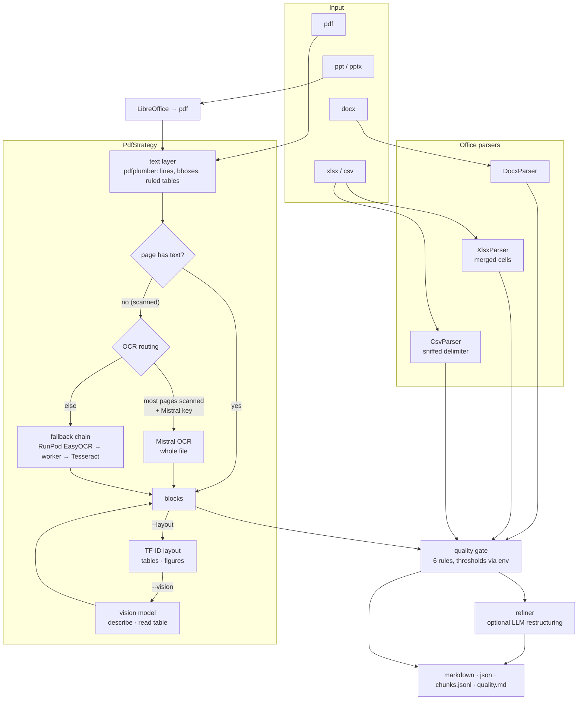

# docparse

Documents in, **structured blocks with provenance** out. PDF, DOCX, XLSX, CSV and PPTX become
pages of typed blocks (heading, text, list item, table, figure), each carrying the page number,
a normalized bounding box, the engine that produced it and its confidence. From that one model
docparse emits Markdown, JSON, RAG chunks and a quality report.

Carved out of a production ingestion pipeline (OCR + layout workers on RunPod, Mistral OCR,
validators feeding a RAG stack) and rebuilt with a clean architecture: domain → application →
infrastructure → interfaces, every external engine behind a port.

```
$ uv run docparse parse report.pdf scan.pdf contract.docx --out out
✓ report.pdf: 12 page(s), 148 block(s), gate=ok, 410 ms → out/report.md
✓ scan.pdf: 3 page(s), 27 block(s), gate=ok, 6120 ms → out/scan.md      # pages OCR'd
✓ contract.docx: 1 page(s), 61 block(s), gate=ok, 38 ms → out/contract.md
```

## What you get

| output | content |
|---|---|
| `<name>.md` | Markdown with `<!-- page N -->` markers, headings, lists, GFM tables, figure descriptions |
| `<name>.json` | the full `Document`: pages → blocks → `provenance {page, bbox, source, confidence}` |
| `<name>.chunks.jsonl` | section-aware chunks for retrieval, each with `section_path` and every source provenance |
| `<name>.quality.md` | quality gate verdict and issues (scanned pages without OCR, low confidence, chart-like tables…) |
| `<name>.refined.md` | optional LLM-restructured version (`--refine`) |

Bounding boxes are normalized (0–1 from the top-left), so a citation stays valid at any render scale.

## Routing



Every engine is optional and they chain. OCR order is **RunPod EasyOCR → HTTP EasyOCR worker →
local Tesseract**: each one is tried only when the previous fails, per page, and the block's
`provenance.source` names the engine that actually answered. Mistral OCR, when configured, handles
mostly-scanned files whole and drops to the per-page chain if it errors. Layout detection follows
the same chain (RunPod → worker) and degrades to "no layout" rather than failing the parse. With
no keys and no workers, docparse runs fully local (pdfplumber + Tesseract). `/health` shows the
active chain.

## Architecture

```
src/docparse/
├── domain/                 pure: no I/O, no frameworks
│   ├── models/             BBox, Provenance, Block/Table, Page, Document, Chunk
│   ├── quality/            QualityIssue, QualityReport
│   ├── ports/              Protocols: pdf, ocr, layout, vision, office, refiner
│   └── services/           segmentation (lines → paragraphs), markdown → blocks
├── application/            use cases, depends on domain only
│   ├── dto/                ParseOptions, ParseResult
│   ├── strategies/         PdfStrategy (routing above), PresentationStrategy
│   ├── engines/            FallbackOcr, FallbackLayout: try engines in order
│   ├── quality/            thresholds, rules (one function each), gate
│   ├── use_cases/          ParseDocument, ChunkDocument, ExportResult
│   └── jobs/               async jobs: Job, JobStore/CallbackNotifier ports, JobService
├── infrastructure/         adapters and wiring
│   ├── adapters/{pdf,ocr,layout,vision,refiner,office}/
│   ├── http/               worker + RunPod transports, callback notifier
│   ├── jobs/               in-memory job store
│   ├── config/             Settings (env), logging
│   └── di/                 Container: Settings → adapters → use cases
└── interfaces/             thin entry points
    ├── cli/commands/       parse, chunks, serve
    └── api/                FastAPI app, routers (health, parse, jobs), dependencies, error mapping
workers/                    GPU model services: easyocr (POST /ocr), tfid (POST /detect)
docker/                     Dockerfile + compose (api, and gpu profile for the workers)
evals/                      scoring harness against ground-truth markdown
```

Dependency rule: arrows point inward only. `domain` imports nothing from the project;
`application` imports `domain`; `infrastructure` implements `domain.ports`; `interfaces` touch
`application` through the container. Adding an OCR engine = one class in
`infrastructure/adapters/ocr/` plus one branch in the container.

## Quality gate

The successor of the old `validator_config.yaml`: rules in
[`application/quality/rules.py`](src/docparse/application/quality/rules.py), thresholds in
`QualityThresholds` (override with `DOCPARSE_QUALITY__<FIELD>`).

| rule | severity | meaning |
|---|---|---|
| `empty_document` | critical | nothing extracted |
| `scanned_without_ocr` | critical / warning | scanned pages left without text (critical when the majority) |
| `low_ocr_confidence` | warning | mean OCR confidence on a page under the threshold |
| `oversized_table` | warning | table above `max_table_cells`, probably a visualisation |
| `chart_like_table` | warning | wide and mostly empty grid: a Gantt/PERT chart rendered as a table |
| `tiny_text` | warning | median text height far below normal: condensed or unreadable |

Verdict: rejected when criticals exceed `max_critical` or more than `max_warning_page_ratio` of
the pages carry warnings. `--strict` turns a rejection into exit code 2 / HTTP 422.

## Install

```bash
uv sync --all-extras          # or: pip install -e ".[all]"
brew install tesseract        # optional local OCR (apt: tesseract-ocr)
cp .env.example .env          # optional engines
```

## Use

```bash
uv run docparse parse FILE... --out out [--ocr auto|never|force] [--layout] [--vision] [--refine] [--strict]
uv run docparse chunks FILE --max-chars 1500
uv run docparse serve --port 8000
```

HTTP API (`Authorization: Bearer $DOCPARSE_API_KEY` when configured):

| endpoint | returns |
|---|---|
| `POST /v1/parse` | full document + report + timings |
| `POST /v1/parse/markdown` | markdown only |
| `POST /v1/parse/chunks?max_chars=` | RAG chunks with provenance |
| `POST /v1/jobs?callback_url=` → `GET /v1/jobs/{id}` | async processing, optional `PUT` callback when done |
| `GET /health` | version, supported suffixes, active engines |

```bash
curl -F file=@report.pdf -H "Authorization: Bearer $KEY" localhost:8000/v1/parse/chunks | jq '.chunks[0]'
```

Docker: `make up` (API) or `docker compose -f docker/docker-compose.yml --profile gpu up` to also
run the EasyOCR and TF-ID workers on a GPU host.

## Python

```python
from docparse.infrastructure.di.container import build_container

c = build_container()
result = await c.parse_document(Path("report.pdf"))
for block in result.document.pages[0].blocks:
    print(block.kind, block.provenance.page, block.provenance.bbox, block.text[:60])
chunks = c.chunk_document(result.document)
```

## Evaluation

`evals/run_eval.py` scores output against ground-truth markdown (edit similarity, table-row
recall). Public benchmark converters (OHR-Bench, OmniDocBench) are the next step; numbers will
land in this README per engine once they run.

## Development

```bash
make check     # ruff + mypy --strict + pytest
make test
```

Tests build their own PDFs, DOCX and XLSX fixtures at runtime (reportlab, python-docx, openpyxl),
so the repo holds no binary blobs. `PdfStrategy` routing is tested with fakes; adapters with real
files; the API through `TestClient`, including the job flow.

## Status

- [x] text-layer PDFs with headings, paragraphs, lists, ruled tables, bboxes
- [x] scanned PDFs via Tesseract, EasyOCR worker (local or RunPod), Mistral OCR
- [x] layout detection (TF-ID worker) + vision description / table reading
- [x] DOCX, XLSX (merged cells), CSV (sniffed delimiter), PPTX via LibreOffice
- [x] quality gate, section-aware chunks, async jobs with callback, Bearer-protected API
- [ ] benchmark numbers (OHR-Bench, OmniDocBench)
- [ ] persistent job store (Redis) for multi-replica deployments
- [ ] Docling / Marker as alternative text-layer engines behind the same port

MIT.
